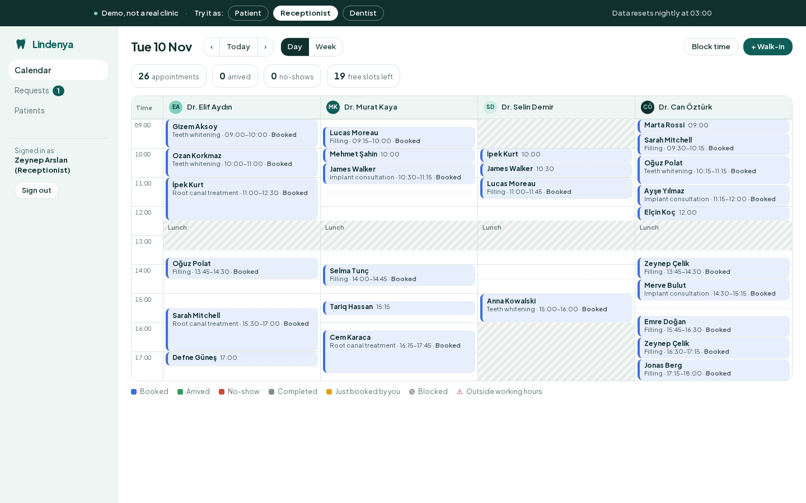
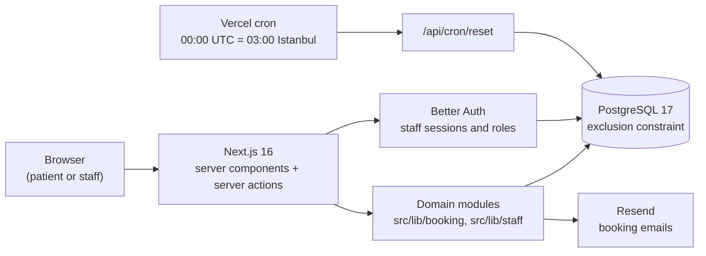

# Lindenya Dental Clinic: online booking demo

A working booking system for a **fictional** dental clinic in Kadıköy, Istanbul, in English and Turkish. Patients book online in four steps, and the clinic's staff run their day from a shared calendar. It is a portfolio project by [Cem Akçiçek](https://github.com/cemakcck). "Lindenya" is an invented name, every person, phone number and address in it is made up, and the app says so on every page.

The point of the project is the part you can't see: **two patients can never end up booked into the same chair at the same time**, whichever path the booking takes (two patients clicking at once, a receptionist dragging an appointment, a dentist blocking time, a walk-in). PostgreSQL itself enforces it. See [Why double booking is impossible](#why-double-booking-is-impossible).



## What you can do

- **As a patient:** browse treatments and dentists, pick a treatment, a dentist (or "anyone available") and a time, and confirm. You get an email with an `.ics` calendar file and a private link to reschedule or cancel. There are no prices anywhere, by design: real clinics quote in person, so the site offers "Call" and "Request a call back" instead.
- **As a receptionist:** a day and week calendar with one column per dentist. Drag to reschedule (or use the keyboard dialog), mark arrivals and no-shows, add walk-ins, block time, work through call-back requests and look up patients.
- **As a dentist:** a phone-friendly "today" list with the next patient highlighted, and full control of your own calendar (blocks, weekly repeats, leave).
- **As an admin:** clinic hours, dentists and treatments.

**Try the magic moment:** book an appointment as a patient, then click "Try it as Receptionist" in the banner. The calendar opens on the day of your booking, with your appointment highlighted.

In demo mode every visitor shares the same data, and it resets every night at 03:00 Istanbul time. A few guards stop one visitor from spoiling the demo for the next: admin settings are view-only, staff actions email nobody, and staff can't block or move away the last free times of the next few days (the capacity floor).

## How it works



- **Next.js 16 (App Router)** renders pages on the server. Every write goes through a server action that validates its input with Zod, checks the user's role, and calls a domain module. There is no client-side data layer.
- **Domain modules** hold the rules. They are plain TypeScript functions that take a database handle, so the integration tests call them directly against a real Postgres: `src/lib/booking` (slots, holds, confirmation, the manage link) and `src/lib/staff` (calendar data, moves, blocks, requests, settings).
- **PostgreSQL 17 with Drizzle ORM.** One `entries` table holds appointments, holds and blocks, so a single constraint covers every kind of overlap.
- **Better Auth** handles staff logins (email and password; patients never log in). **Resend** sends email. Without an API key, emails are written to the log instead of sent.
- **next-intl** serves English and Turkish. All clinic times are Europe/Istanbul and are formatted with `Intl` in that zone, never the server's or the browser's. The unit and integration tests run with `TZ=America/New_York`, so time-zone bugs fail loudly.

## Why double booking is impossible

### 1. The database refuses overlaps

Appointments, holds and blocks all live in one table, each with a dentist and a time range (`tstzrange`). One exclusion constraint forbids two active entries of the same dentist from overlapping:

```sql
CREATE EXTENSION IF NOT EXISTS btree_gist;

ALTER TABLE entries ADD CONSTRAINT entries_no_overlap
  EXCLUDE USING gist (dentist_id WITH =, during WITH &&) WHERE (active);

-- Ranges are always half-open [start, end), finite and non-empty,
-- so 10:00-10:30 and 10:30-11:00 touch without overlapping.
ALTER TABLE entries ADD CONSTRAINT entries_range_valid CHECK (
  NOT isempty(during) AND NOT lower_inf(during) AND NOT upper_inf(during)
  AND lower_inc(during) AND NOT upper_inc(during) AND lower(during) < upper(during));

-- A cancelled appointment can't stay active and keep its slot.
ALTER TABLE entries ADD CONSTRAINT entries_cancelled_inactive
  CHECK (status IS DISTINCT FROM 'cancelled' OR active = false);
```

(From [`drizzle/0001_constraints.sql`](drizzle/0001_constraints.sql) and [`drizzle/0002_range_valid.sql`](drizzle/0002_range_valid.sql).)

The application checks availability first so it can show friendly messages, but correctness doesn't depend on that check. If two requests race past it, Postgres lets exactly one commit and rejects the other with SQLSTATE `23P01`. `withSlotTaken` in [`src/lib/booking/entries.ts`](src/lib/booking/entries.ts) turns that error into `slot_taken`, which the UI shows as a friendly "that time is no longer available, please pick another one".

### 2. Holds reserve the slot while the patient types

Picking a time inserts a **hold**: a row in the same table that expires after 5 minutes ([`src/lib/booking/holds.ts`](src/lib/booking/holds.ts)). Two patients can't both reach the details form with the same slot, because the second hold hits the constraint.

- **Abandoned holds don't block anyone.** An expired hold is still `active`, so every insert or move first deletes the expired holds overlapping its range, in the same transaction.
- **A slow patient still gets the slot if it's free.** Confirming an expired hold re-acquires it atomically. If someone else took it in the meantime, the patient is sent back to the time picker with a friendly message.
- **Double-clicking Confirm makes one appointment.** Confirmation locks the hold row (`FOR UPDATE`) and turns it into the appointment in place. A repeated call finds the appointment already there and returns it. The manage-link token is derived from the hold token, so the repeat returns the same link too.

### 3. Every path goes through the same rule

Every write that sets an entry's time (patient bookings and reschedules, staff moves, walk-ins, blocks) goes through the same two helpers, `insertEntry` and `updateEntryRange`, so the constraint and the `23P01` → `slot_taken` mapping apply everywhere. A block over a booked patient is refused with the list of appointments to move first.

### 4. Concurrent tests against real Postgres

The integration tests in `tests/integration` run against a real Postgres, not mocks:

| Test | What it proves |
| --- | --- |
| `holds.test.ts`: concurrent holds on one slot | 20 simultaneous holds: exactly one wins, 19 get `slot_taken` |
| `holds.test.ts`: concurrent double submit | Two confirms of one hold give one appointment |
| `holds.test.ts`: re-acquiring an expired hold races a new hold | Exactly one of them gets the slot |
| `entries.test.ts`: simultaneous overlapping inserts | 8 transactions released together by a barrier, 15 rounds: one wins, the rest get `slot_taken` |
| `staff-appointments.test.ts`: drag race | A receptionist's move and a patient's booking on the same slot: exactly one wins |
| `blocks.test.ts`: block vs booking race | A block and a booking on the same time: exactly one wins |
| `constraint.test.ts` | The constraint itself: overlaps refused, touching ranges allowed, other dentists and inactive rows ignored |

### What we found and fixed: a deadlock, not a double booking

One concurrency test failed about once in 20 runs. The investigation found a real Postgres deadlock: two inserts checked by the exclusion constraint can each wait for the other's uncommitted row. Postgres only breaks such a cycle after `deadlock_timeout` (1 second), one victim at a time, so a burst of simultaneous bookings stalled for seconds and the losers got a raw `40P01` error instead of `slot_taken`. **The guarantee held every time**: exactly one booking was stored. The bug was the stall and the wrong error code.

The fix: every write first takes a per-dentist advisory lock (`lockDentists`), in ascending dentist id order and before any row lock. Writers to the same dentist now queue, and a loser sees the winner's committed row and gets `23P01` at once. These locks only help liveness; correctness still comes from the constraint. The rules are written down in the `lockDentists` docstring. A barrier test went from about 7 seconds with seven `40P01` errors to about 0.2 seconds with seven `slot_taken`, and Postgres logged no deadlocks in 80 follow-up runs.

## Running locally

You need Node 22 and Docker.

```bash
npm install
npm run db:up                 # Postgres 17 on localhost:5433 (docker compose)
cp .env.example .env.local    # then set BETTER_AUTH_SECRET, e.g. openssl rand -base64 32
npm run db:migrate
npm run demo:reset            # seeds the demo clinic, staff accounts and two weeks of bookings
npm run dev                   # http://localhost:3000
```

`npm run demo:reset` wipes the database in `DATABASE_URL`, so it refuses to run unless `DEMO_MODE=1` (or you pass `--force`). To add a real staff login outside the demo:

```bash
npm run user:create -- --email x@clinic.example --name "Dr. X" --role dentist --dentist elif-aydin --password '…'
```

### Environment variables

| Variable | Required | What it does |
| --- | --- | --- |
| `DATABASE_URL` | yes | Postgres connection string |
| `TEST_DATABASE_URL` | for tests | Base URL of the test databases; `clinic_test`, `clinic_e2e` and `clinic_e2e_live` are created on the same server |
| `BETTER_AUTH_SECRET` | yes | Signs staff sessions. Use a long random value; Better Auth refuses the default in production |
| `BETTER_AUTH_URL` | yes | The app's public URL, for auth |
| `SITE_URL` | in production | Base URL of the manage-booking links in emails; falls back to `http://localhost:3000` |
| `DEMO_MODE` | no | `1` turns on the demo: banner, one-click logins, capacity floor, view-only settings, nightly reset |
| `DEMO_PASSWORD` | in demo mode | Password of the seeded staff accounts; there is no default |
| `RESEND_API_KEY` | no | Without it, emails are logged instead of sent |
| `EMAIL_FROM` | with Resend | Sender address on a domain verified in Resend |
| `IP_HASH_SECRET` | in production | HMAC key for visitor IPs (rate limits). Raw IPs are never stored |
| `CRON_SECRET` | for the nightly reset | Bearer token that `/api/cron/reset` requires |

### Demo accounts

In demo mode the login page has one-click buttons. To sign in with the form, all three accounts use `DEMO_PASSWORD`:

| Role | Email | Can |
| --- | --- | --- |
| Receptionist | `zeynep@staff.example` | Run the calendar for all dentists, requests, patients |
| Dentist | `elif@staff.example` (Dr. Elif Aydın) | See the today view and all calendars; change only her own |
| Admin | `admin@staff.example` | Everything, plus settings (view-only in demo mode) |

## Tests

```bash
npm run lint && npm run typecheck
npm test            # unit (jsdom) + integration (real Postgres on :5433)
npm run test:e2e    # Playwright: starts two dev servers, demo mode on :3200 and live mode on :3201
```

- **Unit:** slot generation (hours, lunch, blocks, holidays, durations, booking window), the "anyone available" choice, permissions, tokens, time zones, email templates, `.ics`, and a check that the English and Turkish message files have identical keys.
- **Integration:** the overlap guarantee and the races above, holds, the manage link, staff moves and blocks, the capacity floor, auth, email caps and the demo seed.
- **End-to-end:** the full patient booking (from a London time zone, to show the times stay in Istanbul time), the manage link, the "Try it as Receptionist" moment, drag and keyboard rescheduling, dentist blocks and conflict refusals, call-back requests, settings, EN/TR, the capacity floor holding while a receptionist tries to block out the next three days, and an accessibility sweep.

**Accessibility:** axe runs on every public page in both languages and on every staff page, and allows zero serious or critical violations. The calendar is fully usable with the keyboard. All colour pairs meet WCAG AA. The one adjustment was the decorative "404" numeral on the not-found page, which moved from the mint accent (1.6:1 on its background) to the secondary teal (3.8:1, AA for large text).

**Lighthouse** (desktop preset, home page, production build): Performance 100, Accessibility 100, Best Practices 100, SEO 100.

**CI:** GitHub Actions ([`.github/workflows/ci.yml`](.github/workflows/ci.yml)) runs lint, typecheck, and the unit, integration and end-to-end tests on every push and pull request, with Postgres 17 as a service container.

## Clinic name check

The name was checked so it doesn't belong to a real clinic. On 2026-11-08, web searches for "Lindenya diş kliniği İstanbul" and "Lindenya dental Istanbul" returned no result mentioning Lindenya, only unrelated clinics. Contact details use reserved, non-working values such as `.example` domains.

## Before deploying

The app is meant to run on Vercel with Neon Postgres. Before putting it online:

- **Database:** create a Neon Postgres database, set `DATABASE_URL`, run `npm run db:migrate`, and for the demo run `DEMO_MODE=1 npm run demo:reset`.
- **`BETTER_AUTH_SECRET`:** set a fresh long random value; Better Auth refuses to start in production with the default. Set `BETTER_AUTH_URL` and `SITE_URL` to the real URL, or the manage links in emails will point at localhost.
- **`CRON_SECRET`:** `vercel.json` schedules `/api/cron/reset` at 00:00 UTC (03:00 Istanbul). Vercel sends the secret as a bearer token, and the route rejects requests without it. It only resets when `DEMO_MODE=1`.
- **`IP_HASH_SECRET`:** without it, IP hashes use a public default key.
- **Resend:** set `RESEND_API_KEY` and an `EMAIL_FROM` address on a domain verified in Resend. The default sender, `hello@lindenya.example`, would be rejected.
- **Run behind a proxy that sets `X-Forwarded-For`** (Vercel does). Rate limits key on the client IP; without the header, every visitor shares one bucket.
