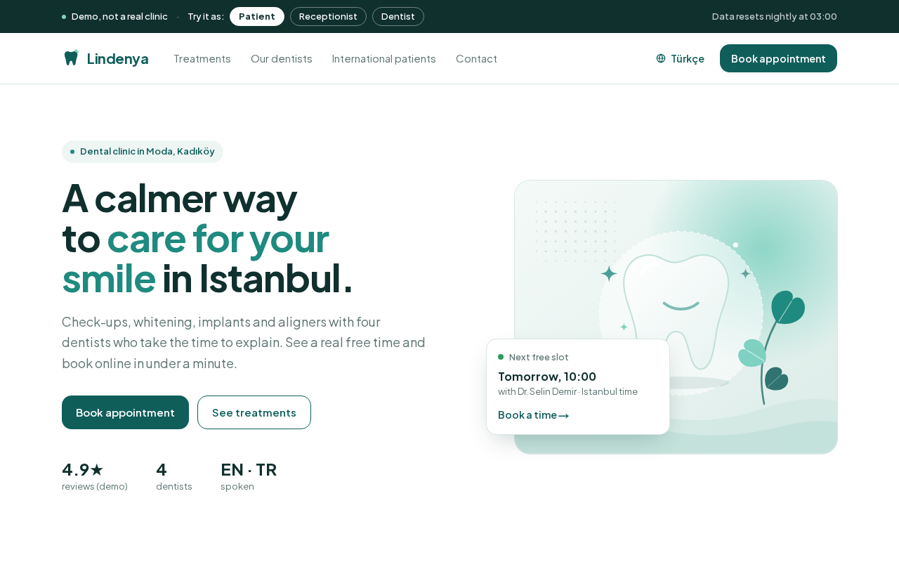
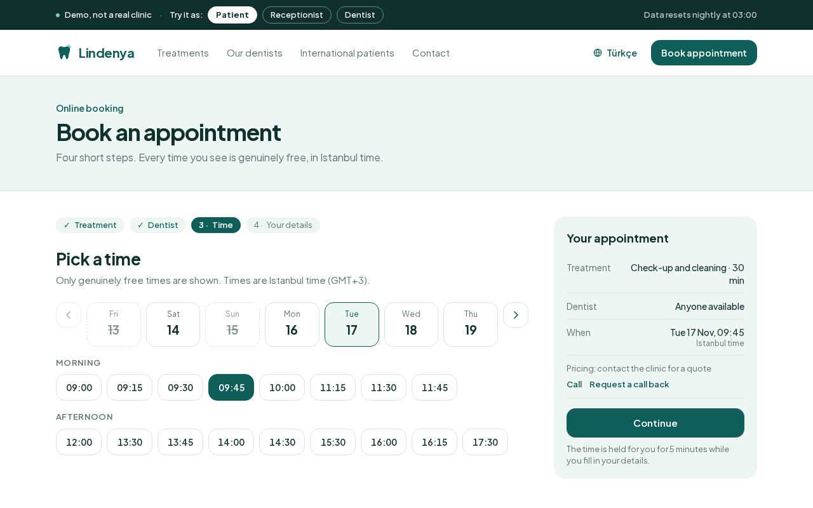
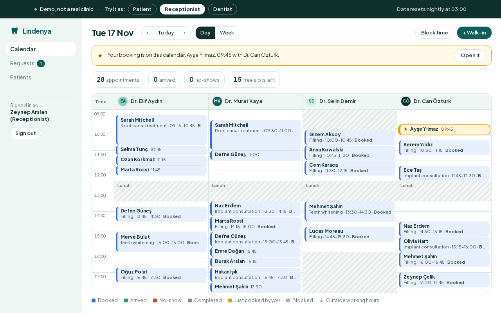
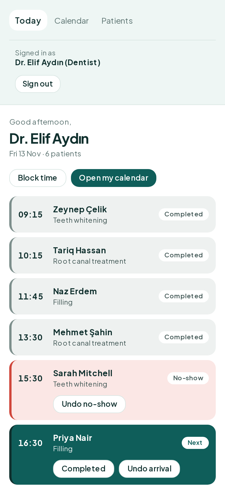
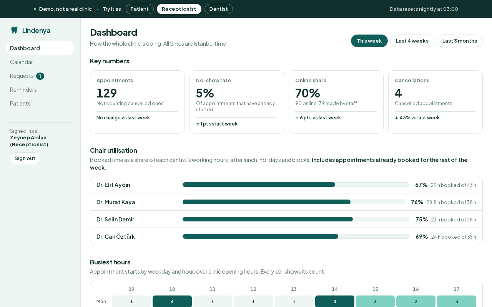
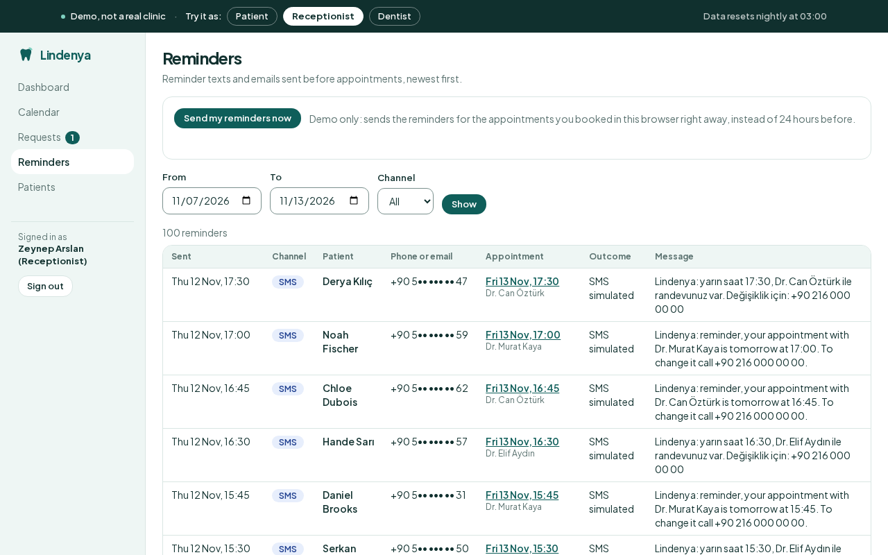
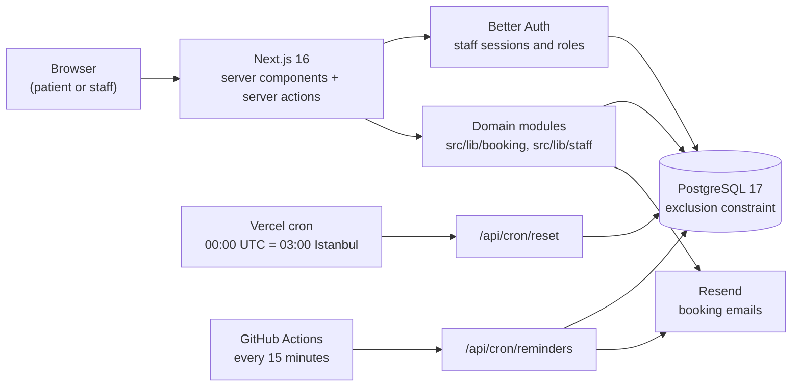

# Lindenya Dental: clinic booking system

Online booking and a staff calendar for a fictional dental clinic in Istanbul, built so that **two patients can never be booked into the same chair at the same time**. PostgreSQL enforces that rule, not just the application code.

[](https://github.com/cemakcck/clinic-booking/actions/workflows/ci.yml)
[](LICENSE)

**Live demo:** https://clinic.cemakcicek.com (launching soon) · **Portfolio:** [cemakcicek.com](https://cemakcicek.com) · **GitHub:** [@cemakcck](https://github.com/cemakcck)

Next.js 16 · TypeScript · Tailwind CSS 4 · PostgreSQL 17 · Drizzle ORM · Better Auth · next-intl (English/Turkish) · Vitest · Playwright

| Patient site | Booking: pick a time |
| --- | --- |
|  |  |
| **Receptionist calendar** | **Dentist's day (phone)** |
|  |  |
| **Dashboard** | **Reminders log** |
|  |  |

"Lindenya" is an invented name. Every person, phone number and address in the app is made up, and the app says so on every page.

## What it does

- **Patients** browse treatments and dentists, then book in four steps: treatment, dentist (or "anyone available"), time, details. They get a confirmation email with an `.ics` file and a private link to reschedule or cancel, and a reminder 24 hours before the appointment (an email in their language, plus a simulated SMS). Patients never create an account. There are no prices, by design: the site offers "Call" and "Request a call back" instead.
- **Receptionists** work from a day and week calendar with one column per dentist: drag to reschedule (or use the keyboard dialog), mark arrivals and no-shows, add walk-ins, block time, work through call-back requests and look up patients. A **Reminders log** lists every reminder email and simulated SMS, with the outcome and the message text. In demo mode, "Send my reminders now" sends the reminders for the bookings you made yourself right away, so you can see one without waiting a day.
- **Dentists** get a phone-friendly "today" list with the next patient highlighted, and manage their own calendar: blocks, weekly repeats, leave.
- **Admins** edit clinic hours, dentists and treatments.
- **Dashboard** (receptionists and admins see the whole clinic, a dentist sees only their own numbers): this week, the last 4 weeks or the last 3 months, each compared with the period before. It shows appointments, no-show rate, online share and cancellations, chair utilisation per dentist and a heatmap of the busiest hours.

**Try this:** book an appointment as a patient, then click "Try it as Receptionist". The calendar opens on the day of your booking with your appointment highlighted.

In demo mode every visitor shares the same data, which resets every night at 03:00 Istanbul time. Visitors switch roles with one click from the banner, without a password. A few guards keep one visitor from spoiling the demo for the next: admin settings are view-only, staff actions email nobody, other patients' contact details are masked, and staff can't block or move away the last free times of the next few days (the capacity floor). Reminders for bookings that staff create are only logged in demo mode, never sent, and an email only goes to an address a visitor typed into their own booking, with daily limits per address and per IP.

## Engineering decisions

- **Double booking is prevented by the database.** Appointments, holds and blocks share one `entries` table, and a Postgres `EXCLUDE USING gist` constraint forbids two active entries of the same dentist from overlapping. This is why the project uses Postgres. Details [below](#why-double-booking-is-impossible).
- **Holds.** Picking a time reserves it for 5 minutes as a row in the same table, so two patients can't both reach the details form for one slot. Expired holds are cleaned up inside the next write's transaction, and confirming is idempotent.
- **One write path.** Patient bookings, reschedules, staff drags, walk-ins and blocks all go through the same two helpers, so every path gets the same constraint and the same "that time was just taken" error.
- **Time zones.** All clinic times are Europe/Istanbul, formatted with `Intl` in that zone, never the server's or the browser's. Unit and integration tests run with `TZ=America/New_York`, and an end-to-end test books from a London browser, so time-zone bugs fail loudly.
- **Two languages.** English and Turkish via next-intl, with a unit test that both message files have identical keys.
- **Roles and permissions.** Better Auth handles staff sessions. Receptionist, dentist and admin rights live in one permission table ([`src/lib/auth/permissions.ts`](src/lib/auth/permissions.ts)) that both pages and server actions check; a dentist can view every calendar but change only their own.
- **Privacy by omission (KVKK-minded).** The app stores a patient's name, phone, optional email and the appointment, nothing more: no medical records, notes or health data. Visitor IPs are only stored as HMAC hashes, for rate limits. Manage links are random tokens stored hashed.
- **Reminders exactly once.** A GitHub Actions schedule calls `/api/cron/reminders` every 15 minutes. Each reminder is claimed with a unique database row before anything is sent, so overlapping runs or retries can't send one twice. Nothing is sent for an appointment booked or moved less than 24 hours before the start. Email and SMS text use the patient's language, and SMS is simulated: the message is stored in the reminders log, not sent.
- **Dashboard numbers.** Utilisation is booked time as a share of each dentist's working hours after lunch, holidays and blocks. All periods are computed in Istanbul time, and a dentist's role limits the queries themselves to their own appointments.
- **Demo reset.** A Vercel cron calls `/api/cron/reset` nightly; it needs a bearer secret and refuses to run unless `DEMO_MODE=1`. The seed generates 26 weeks of realistic booking history (so the dashboard has something to compare) plus upcoming bookings around the current date.

## Architecture



- **Next.js 16 (App Router)** renders pages on the server. Every write is a server action that validates input with Zod, checks the user's role, and calls a domain module. There is no client-side data layer.
- **Domain modules** hold the rules. They are plain TypeScript functions that take a database handle, so integration tests call them directly against a real Postgres.
- **Email** goes through Resend, and reminders are sent by a scheduled call to `/api/cron/reminders`. Without an API key, emails are written to the server log instead, so nothing external is needed to run the app.

## Why double booking is impossible

### 1. The database refuses overlaps

Appointments, holds and blocks all live in one table, each with a dentist and a time range (`tstzrange`). One exclusion constraint forbids two active entries of the same dentist from overlapping:

```sql
CREATE EXTENSION IF NOT EXISTS btree_gist;

ALTER TABLE entries ADD CONSTRAINT entries_no_overlap
  EXCLUDE USING gist (dentist_id WITH =, during WITH &&) WHERE (active);

-- Ranges are always half-open [start, end), finite and non-empty,
-- so 10:00-10:30 and 10:30-11:00 touch without overlapping.
ALTER TABLE entries ADD CONSTRAINT entries_range_valid CHECK (
  NOT isempty(during) AND NOT lower_inf(during) AND NOT upper_inf(during)
  AND lower_inc(during) AND NOT upper_inc(during) AND lower(during) < upper(during));

-- A cancelled appointment can't stay active and keep its slot.
ALTER TABLE entries ADD CONSTRAINT entries_cancelled_inactive
  CHECK (status IS DISTINCT FROM 'cancelled' OR active = false);
```

(From [`drizzle/0001_constraints.sql`](drizzle/0001_constraints.sql) and [`drizzle/0002_range_valid.sql`](drizzle/0002_range_valid.sql).)

The application checks availability first so it can show friendly messages, but correctness doesn't depend on that check. If two requests race past it, Postgres lets exactly one commit and rejects the other with SQLSTATE `23P01`. `withSlotTaken` in [`src/lib/booking/entries.ts`](src/lib/booking/entries.ts) turns that error into `slot_taken`, which the UI shows as a friendly "that time is no longer available, please pick another one".

### 2. Holds reserve the slot while the patient types

Picking a time inserts a **hold**: a row in the same table that expires after 5 minutes ([`src/lib/booking/holds.ts`](src/lib/booking/holds.ts)). Two patients can't both reach the details form with the same slot, because the second hold hits the constraint.

- **Abandoned holds don't block anyone.** An expired hold is still `active`, so every insert or move first deletes the expired holds overlapping its range, in the same transaction.
- **A slow patient still gets the slot if it's free.** Confirming an expired hold re-acquires it atomically. If someone else took it in the meantime, the patient is sent back to the time picker with a friendly message.
- **Double-clicking Confirm makes one appointment.** Confirmation locks the hold row (`FOR UPDATE`) and turns it into the appointment in place. A repeated call finds the appointment already there and returns it. The manage-link token is derived from the hold token, so the repeat returns the same link too.

### 3. Every path goes through the same rule

Every write that sets an entry's time (patient bookings and reschedules, staff moves, walk-ins, blocks) goes through the same two helpers, `insertEntry` and `updateEntryRange`, so the constraint and the `23P01` → `slot_taken` mapping apply everywhere. A block over a booked patient is refused with the list of appointments to move first.

### 4. Concurrent tests against real Postgres

The integration tests in `tests/integration` run against a real Postgres, not mocks:

| Test | What it proves |
| --- | --- |
| `holds.test.ts`: concurrent holds on one slot | 20 simultaneous holds: exactly one wins, 19 get `slot_taken` |
| `holds.test.ts`: concurrent double submit | Two confirms of one hold give one appointment |
| `holds.test.ts`: re-acquiring an expired hold races a new hold | Exactly one of them gets the slot |
| `entries.test.ts`: simultaneous overlapping inserts | 8 transactions released together by a barrier, 15 rounds: one wins, the rest get `slot_taken` |
| `staff-appointments.test.ts`: drag race | A receptionist's move and a patient's booking on the same slot: exactly one wins |
| `blocks.test.ts`: block vs booking race | A block and a booking on the same time: exactly one wins |
| `constraint.test.ts` | The constraint itself: overlaps refused, touching ranges allowed, other dentists and inactive rows ignored |

### What we found and fixed: a deadlock, not a double booking

One concurrency test failed about once in 20 runs. The investigation found a real Postgres deadlock: two inserts checked by the exclusion constraint can each wait for the other's uncommitted row. Postgres only breaks such a cycle after `deadlock_timeout` (1 second), one victim at a time, so a burst of simultaneous bookings stalled for seconds and the losers got a raw `40P01` error instead of `slot_taken`. **The guarantee held every time**: exactly one booking was stored. The bug was the stall and the wrong error code.

The fix: every write first takes a per-dentist advisory lock (`lockDentists`), in ascending dentist id order and before any row lock. Writers to the same dentist now queue, and a loser sees the winner's committed row and gets `23P01` at once. These locks only help liveness; correctness still comes from the constraint. The rules are written down in the `lockDentists` docstring. A barrier test went from about 7 seconds with seven `40P01` errors to about 0.2 seconds with seven `slot_taken`, and Postgres logged no deadlocks in 80 follow-up runs.

## Running locally

You need **Node.js 22+** and **Docker** (with Compose). No cloud account or API key is needed.

```bash
git clone https://github.com/cemakcck/clinic-booking.git && cd clinic-booking
npm install
npm run db:up                 # Postgres 17 in Docker on localhost:5433
cp .env.example .env.local    # the defaults work as-is for local use
npm run db:migrate
npm run demo:reset            # seeds the clinic, staff accounts and 26 weeks of booking history
npm run dev                   # http://localhost:3000
```

Open http://localhost:3000, book an appointment, then use the "Try it as" buttons in the banner to switch to Receptionist or Dentist.

- **Port 5433 already taken?** Start the database with `CLINIC_DB_PORT=5434 npm run db:up` and change `5433` to `5434` in `.env.local` (and export `TEST_DATABASE_URL` with the new port before running tests).
- **Email** is logged to the terminal running `npm run dev` unless you set `RESEND_API_KEY` and `EMAIL_FROM`.
- `npm run demo:reset` wipes the database in `DATABASE_URL`, so it refuses to run unless `DEMO_MODE=1` (or you pass `--force`).

### Demo accounts

In demo mode the banner and the staff login page sign you in with one click. To use the login form instead, all accounts share the `DEMO_PASSWORD` from `.env.local` (`change-me-demo-password` by default):

| Role | Email | Can |
| --- | --- | --- |
| Receptionist | `zeynep@staff.example` | Run the calendar for all dentists, requests, patients |
| Dentist | `elif@staff.example` (Dr. Elif Aydın) | See the today view and all calendars; change only her own |
| Admin | `admin@staff.example` | Everything, plus settings (view-only in demo mode) |

Outside demo mode, add a staff login with:

```bash
npm run user:create -- --email x@clinic.example --name "Dr. X" --role dentist --dentist elif-aydin --password '…'
```

### Environment variables

| Variable | Required | What it does |
| --- | --- | --- |
| `DATABASE_URL` | yes | Postgres connection string |
| `TEST_DATABASE_URL` | for tests | Base URL of the test databases; `clinic_test`, `clinic_e2e` and `clinic_e2e_live` are created on the same server. Read from the shell environment, not `.env.local` (default: the docker-compose database) |
| `BETTER_AUTH_SECRET` | yes | Signs staff sessions and the demo cookie. The `.env.example` value is for local use only |
| `BETTER_AUTH_URL` | yes | The app's public URL, for auth |
| `SITE_URL` | in production | Base URL of the manage-booking links in emails; falls back to `http://localhost:3000` |
| `DEMO_MODE` | no | `1` turns on the demo: banner, one-click logins, capacity floor, view-only settings, nightly reset |
| `DEMO_PASSWORD` | in demo mode | Password of the seeded staff accounts |
| `RESEND_API_KEY`, `EMAIL_FROM` | no | Send real email through Resend; without them emails are logged |
| `IP_HASH_SECRET` | in production | HMAC key for visitor IPs (rate limits). Raw IPs are never stored |
| `CRON_SECRET` | for the crons | Bearer token that `/api/cron/reset` and `/api/cron/reminders` require; also the GitHub Actions secret of the reminders workflow |

## Tests

```bash
npm run lint && npm run typecheck
npm test                          # 117 unit + 216 integration tests (needs the database from npm run db:up)
npx playwright install chromium   # once, for the end-to-end tests
npm run test:e2e                  # 85 Playwright tests; starts its own dev servers on :3200 and :3201
```

The first end-to-end run compiles every page in two dev servers and can take several minutes; on a slow machine a cold compile can time out a test or two. `npx playwright test --last-failed` re-runs just those. CI retries once for the same reason.

- **Unit (119):** slot generation (hours, lunch, blocks, holidays, durations, booking window), the "anyone available" choice, permissions, tokens, time zones, email templates, `.ics`, reminder timing and messages, dashboard calculations, and EN/TR message-key parity.
- **Integration (223), against a real Postgres:** the overlap guarantee and the races above, holds, the manage link, staff moves and blocks, the capacity floor, auth, demo masking, email caps, the demo seed, and the reminder run (exactly-once claims, the 24-hour rule, demo and staff-booking rules).
- **End-to-end (85):** the full patient booking from a London time zone, the manage link, the "Try it as Receptionist" flow, drag and keyboard rescheduling, dentist blocks and conflict refusals, call-back requests, settings, EN/TR, the capacity floor, and the reminders log and send-now flow, the dashboard for each role, and an accessibility sweep.

**Accessibility:** axe runs on every public page in both languages and on every staff page, and allows zero serious or critical violations. The calendar is fully usable with the keyboard, and all colour pairs meet WCAG AA.

**CI:** GitHub Actions ([`.github/workflows/ci.yml`](.github/workflows/ci.yml)) runs lint, typecheck, unit, integration and end-to-end tests and a production build on every push and pull request, with Postgres 17 as a service container.

## Project structure

```
src/
  app/[locale]/(public)/    patient site and booking flow (EN/TR routes)
  app/[locale]/staff/       staff login, dashboard, calendar, today, requests, reminders, patients, settings
  app/api/                  auth, .ics download, demo-reset and reminders crons
  components/               booking, calendar, site and staff UI
  lib/booking/              slots, holds, confirmation, manage link, the write helpers
  lib/staff/                calendar data, moves, blocks, requests, settings
  lib/reminders/            reminder run, simulated SMS, send-now, log queries
  lib/dashboard/            dashboard metrics and periods
  lib/db/                   Drizzle schema and client
  lib/demo/                 demo mode, seed, reset, capacity floor, masking
  lib/auth/, lib/security/  Better Auth setup, permissions, tokens, rate limits, IP hashing
drizzle/                    SQL migrations, including the exclusion constraint
messages/                   en.json and tr.json
scripts/                    migrate, seed, demo reset, create staff user
tests/unit, tests/integration, tests/e2e
docs/                       deploy notes, design spec and implementation plan
```

## Known limits

- One clinic, by design. No payments or prices, SMS is simulated (logged, not sent), no patient accounts (patients manage a booking through its private link).
- Email needs a Resend account and a verified sender domain; locally it is logged.
- Demo data is public and shared between visitors, and wiped every night.
- Not deployed yet. The Vercel + Supabase setup is prepared but untested in production.

## Deploying

The app targets Vercel with Supabase Postgres (any Postgres 17 works). In short: migrate and seed the database, set the environment variables above with fresh secrets, let `vercel.json` schedule the nightly reset, and add two GitHub secrets so the reminders workflow can call the app. Step-by-step notes are in [docs/DEPLOY.md](docs/DEPLOY.md).

## Clinic name check

On 2026-11-08, web searches for "Lindenya diş kliniği İstanbul" and "Lindenya dental Istanbul" returned no clinic with that name. The phone number (`+90 216 000 00 00`) is an all-zero placeholder, the street address is invented and labelled fictional, and emails use the reserved `.example` domain.

## License

[MIT](LICENSE) © Cem Akçiçek
